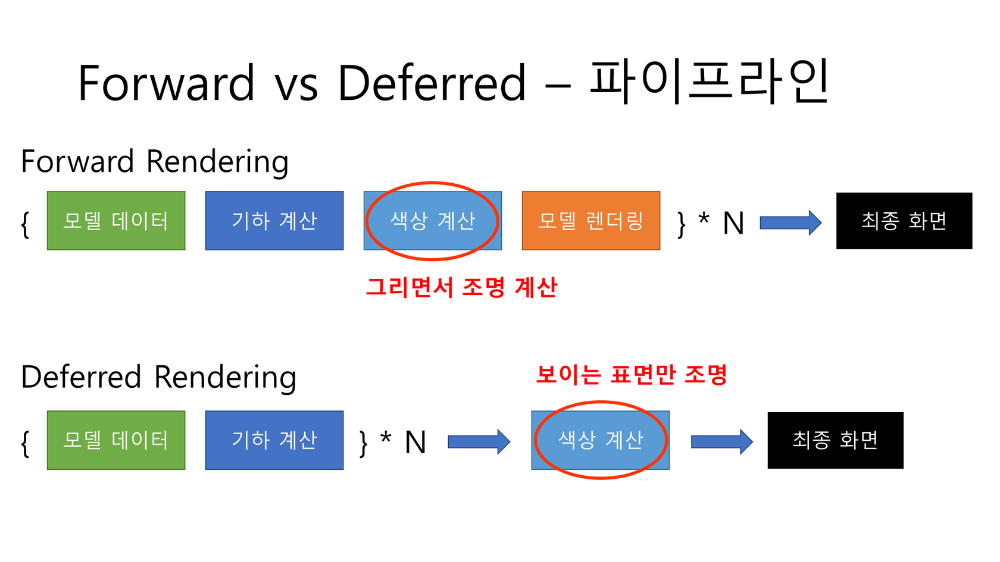

<h1 align="center">Deferred Rendering 소개</h1>

Deferred 렌더링의 원리와 한계, 해결 방안을 다룬 GDG 2025 발표 자료

  
  

## Contents

* [프로젝트 소개](#프로젝트-소개)
* [Forward의 낭비와 Deferred의 두 단계](#forward의-낭비와-deferred의-두-단계)
* [G-buffer 구성](#g-buffer-구성)
* [Forward와 Deferred의 성능 비교](#forward와-deferred의-성능-비교)
* [Deferred의 한계](#deferred의-한계)
* [발표 자료](#발표-자료)

## 프로젝트 소개

부경대학교 GDG 2025에서 Deferred Rendering의 원리와 한계, 해결 방법을 발표했습니다. C++과 Direct3D 11로 만든 렌더러에서 같은 창고 장면을 Forward와 Deferred로 그리고, 조명 수에 따라 두 기법의 GPU 시간이 어떻게 달라지는지 분석해 Deferred Rendering의 트레이드오프를 설명했습니다. 후반에는 Deferred에서 어려워지는 안티앨리어싱과 반투명 물체 처리를 다뤘습니다.

## Forward의 낭비와 Deferred의 두 단계

Forward는 물체를 그리면서 머테리얼과 조명을 함께 계산합니다. 앞쪽 물체가 나중에 그려지면, 먼저 그린 뒤쪽 표면의 조명 계산이 그대로 버려질 수 있습니다.

Deferred는 지오메트리 패스와 라이팅 패스를 분리합니다. 지오메트리 패스에서 불투명 표면의 노멀과 머테리얼을 G-buffer에 기록하면, 깊이 테스트를 거쳐 각 픽셀에 가장 가까운 표면만 남습니다. 라이팅 패스는 이 표면을 읽어 빛을 계산합니다.

## G-buffer 구성

렌더러는 MRT(Multiple Render Targets)로 노멀, 알베도·러프니스, 메탈릭·AO 값을 세 렌더 타깃에 기록하고, 깊이 버퍼를 함께 사용합니다. 아래 디버그 화면은 라이팅 패스에 넘기는 네 버퍼를 보여줍니다.

G-buffer는 모든 물체가 쓰고 라이팅 패스가 다시 읽으므로, 크기가 곧 메모리 대역폭 비용입니다. 대역폭을 줄이기 위해 두 가지를 적용했습니다.

- 월드 위치 버퍼를 두지 않고 깊이에서 복원합니다. 픽셀 좌표와 깊이에 역투영·역뷰 변환을 적용하면 라이팅에 필요한 위치를 얻을 수 있습니다.
- 값의 범위에 맞는 경량 포맷을 씁니다. [0, 1] 범위로 충분한 머테리얼 값은 8비트 정규화 포맷(`R8G8B8A8_UNORM`)에 담고, 음수와 정밀도가 필요한 노멀에만 16비트 부동소수점 포맷(`R16G16B16A16_FLOAT`)을 씁니다.

## Forward와 Deferred의 성능 비교

이론적으로 Forward는 조명 비용이 "그려진 모든 픽셀 × 광원 수"로 늘어나고, Deferred는 G-buffer를 쓰고 읽는 고정 비용을 낸 뒤 "보이는 픽셀 × 광원이 닿는 범위"만 계산합니다. 따라서 조명이 적으면 G-buffer 비용 때문에 Deferred가 손해이고, 조명이 많아져 Forward의 조명 비용이 G-buffer 비용을 넘어서는 지점부터 Deferred가 유리해집니다. 이 손익 분기점을 확인하려고 조명 수를 바꿔 가며 두 기법을 측정했습니다.

RTX 4060 Laptop GPU, 1280×720에서 불투명 도형 2,556개를 같은 PBR 머테리얼로 그렸습니다. Forward는 픽셀 셰이더에서 모든 작업등의 범위를 확인하고, Deferred는 광원마다 구형 라이트 볼륨을 그려 해당 영역의 픽셀만 검사합니다.

| 작업등 | Forward | Deferred | Deferred의 G-buffer | Deferred의 라이팅 + 합성 |
| --- | ---: | ---: | ---: | ---: |
| 꺼짐 | 0.152 ms | 0.169 ms | 0.156 ms | 0.013 ms |
| 8개 | 0.177 ms | 0.193 ms | — | — |
| 32개 | 0.383 ms | 0.307 ms | 0.146 ms | 0.162 ms |
| 128개 | 1.234 ms | 0.784 ms | 0.147 ms | 0.637 ms |

작업등이 없거나 8개일 때는 G-buffer 비용(약 0.15 ms) 때문에 Forward가 빨랐습니다. 32개부터 순서가 바뀌었고, 128개에서는 Deferred가 36.4% 빨랐습니다. G-buffer 시간은 조명 수와 관계없이 일정했고, 늘어난 비용은 라이팅 단계에만 쌓였습니다. 예측한 대로 조명이 늘수록 Deferred의 고정 비용이 상쇄되는 구조입니다.

### Early-Z를 고려한 비교

Forward의 낭비가 가려진 픽셀에서 온다면, 가까운 물체부터 그려 GPU의 Early-Z가 가려진 픽셀의 셰이딩을 건너뛰게 할 수 있습니다. 그렇다면 Forward를 최적화해도 Deferred가 유리할까요? 같은 장면을 그리기 순서만 바꿔 다시 측정했습니다.

| 작업등 | Forward (먼 순서) | Deferred (먼 순서) | Forward (가까운 순서) | Deferred (가까운 순서) |
| --- | ---: | ---: | ---: | ---: |
| 꺼짐 | 0.181 ms | 0.199 ms | 0.152 ms | 0.169 ms |
| 32개 | 0.670 ms | 0.375 ms | 0.383 ms | 0.307 ms |
| 128개 | 1.581 ms | 0.825 ms | 1.234 ms | 0.784 ms |

가까운 순서로 그리자 작업등 128개에서 Forward의 픽셀 셰이더 호출이 1,934,731회에서 1,625,127회로 약 16% 줄었고, 시간도 1.581 ms에서 1.234 ms로 줄었습니다. 그래도 Deferred(0.784 ms)보다 느렸습니다. Early-Z는 가려진 픽셀을 줄일 뿐, 실행된 픽셀마다 모든 광원을 확인하는 비용은 그대로이기 때문입니다. 조명이 적은 장면에서는 최적화한 Forward가, 조명이 많은 장면에서는 Deferred가 유리하다는 결론입니다.

## Deferred의 한계

### 안티앨리어싱

MSAA는 픽셀마다 여러 샘플의 커버리지를 하드웨어가 처리하는 방식입니다. Deferred는 G-buffer에 기록한 기하 정보를 라이팅에서 다시 읽어야 하는데, MSAA를 쓰려면 G-buffer 전체를 샘플 수만큼 저장하고 라이팅도 샘플마다 해야 해서 대역폭과 메모리 비용이 크게 늘어납니다. 그래서 Deferred에서는 하드웨어 AA 대신 후처리 AA를 직접 구현합니다.

렌더러에는 FXAA를 구현했습니다. 최종 색상의 휘도 차이로 경계를 찾고, 경계 방향을 따라 주변 픽셀과 섞습니다. 추가 G-buffer 샘플이 필요 없지만, 가는 선이나 텍스처는 흐려질 수 있습니다. 발표에서는 이전 프레임의 결과를 누적해 경계를 다듬는 TAA도 대안으로 소개했습니다.

### 반투명 물체

G-buffer에는 픽셀마다 가장 가까운 표면 하나만 남습니다. 유리처럼 뒤가 비치는 물체는 여러 표면의 색을 섞어야 하므로 Deferred 파이프라인만으로는 그릴 수 없습니다. 발표에서는 세 가지 해결 방법을 비교했습니다.

1. Forward 패스 분리: 불투명 물체를 Deferred로 그린 뒤, 반투명 물체만 깊이순으로 정렬해 Forward로 그립니다. 기존 방식을 그대로 쓸 수 있지만 물체 단위 정렬이라, 서로 교차하는 반투명 물체는 순서가 틀어질 수 있습니다.
2. 디더링 근사: 투명도에 비례해 픽셀을 솎아 내고 불투명 패스에서 그립니다. 별도 패스가 필요 없어 가볍지만, 아래 그림처럼 패턴이 보입니다.
3. OIT(Order-Independent Transparency): 픽셀마다 여러 반투명 표면을 모아 합성해 그리기 순서에 덜 의존합니다. 결과는 정확하지만 표면을 저장할 추가 메모리가 필요합니다.

## 발표 자료

* [발표 자료 PDF](Deferred%20Rendering%20%EC%86%8C%EA%B0%9C.pdf)
* [발표 자료 PPTX](Deferred%20Rendering%20%EC%86%8C%EA%B0%9C.pptx)
