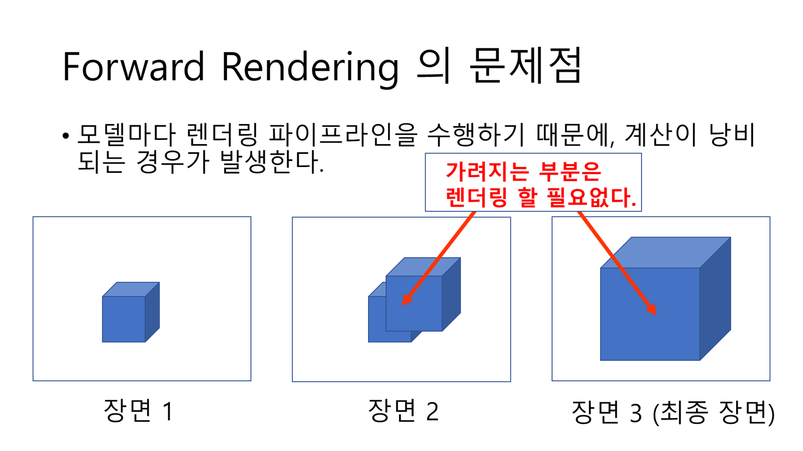
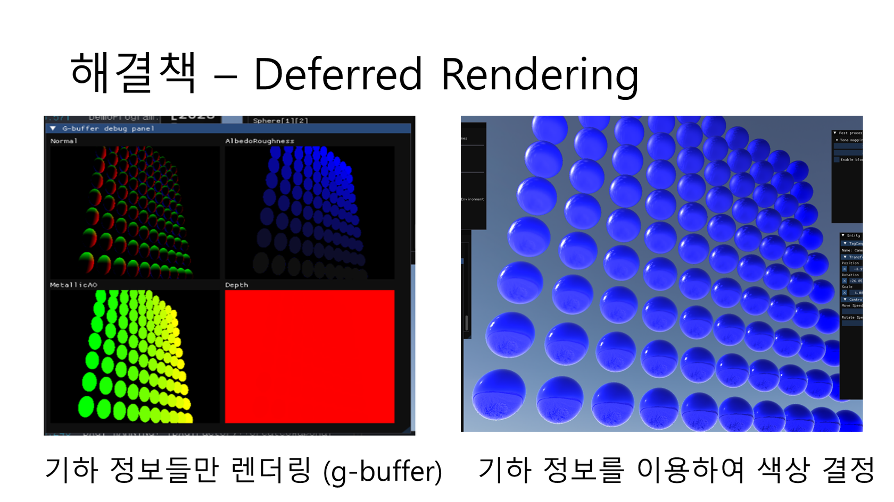

# Deferred Rendering 소개

부경대학교 프로그래밍 동아리 GDC에서 Deferred Rendering을 주제로 발표한 자료입니다. Forward Rendering에서 계산이 낭비되는 지점을 짚고, Deferred Rendering이 이를 어떻게 줄이는지 설명한 뒤, C++과 Direct3D 11로 직접 만든 벤치마크에서 두 방식을 같은 조건으로 비교했습니다.

발표는 렌더링과 빛, 재질에 대한 배경지식에서 시작해 Forward Rendering의 한계, Deferred Rendering의 2단계 구조와 G-buffer 최적화로 이어집니다. 후반부에서는 조명 개수와 그리기 순서를 바꿔 가며 측정한 결과로 "Deferred가 항상 빠른가?"라는 질문에 답하고, 마지막으로 Deferred Rendering의 한계인 안티앨리어싱과 반투명 물체 처리를 해결 방안과 함께 다뤘습니다.

## Contents

- [Forward Rendering의 한계](#forward-rendering의-한계)
- [Deferred Rendering](#deferred-rendering)
- [G-buffer 최적화](#g-buffer-최적화)
- [성능 비교 — Deferred는 항상 빠를까?](#성능-비교--deferred는-항상-빠를까)
- [Early-Z와 그리기 순서](#early-z와-그리기-순서)
- [결론 — 언제 어떤 방식을 쓸까?](#결론--언제-어떤-방식을-쓸까)
- [안티앨리어싱](#안티앨리어싱)
- [반투명 물체 처리](#반투명-물체-처리)
- [발표 자료](#발표-자료)

## Forward Rendering의 한계

3D 물체를 그리려면 픽셀마다 위치와 색을 정해야 하고, 색을 정하려면 빛과 법선 벡터, 거칠기(Roughness)·금속성(Metallic)·발광(Emission) 같은 재질 정보가 필요합니다. 언리얼 엔진 4의 PBR 수식처럼 이 계산은 무겁고, 1280×720 화면을 초당 60장 그리면 초당 약 5,530만 픽셀을 칠하게 됩니다.

Forward Rendering은 모델마다 위치 변환 → 픽셀 색상 계산 → 깊이·스텐실 테스트와 블렌딩으로 이어지는 파이프라인을 한 번씩 수행합니다. 즉 물체를 그리면서 재질과 조명을 함께 계산하므로, 광원이 많으면 픽셀 셰이더 단계가 병목이 됩니다. 게다가 나중에 다른 모델에 가려질 픽셀의 색상까지 미리 계산하게 됩니다.

*발표 자료 17쪽 — 앞서 계산한 픽셀이 다음 모델에 가려지는 과정*

## Deferred Rendering

Deferred Rendering은 불투명 물체를 두 단계로 나눠 그립니다.

1. **표면 정보를 G-buffer에 기록합니다.** 깊이 테스트를 거치면 픽셀마다 맨 앞 표면의 법선과 재질만 남습니다.
2. **저장한 표면에 조명을 적용합니다.** 각 픽셀에 영향을 주는 광원의 빛을 더합니다.

뒤에 가려진 표면은 조명 계산을 건너뛰므로, 무거운 빛과 재질 수식은 화면에 실제로 보이는 표면에만 적용됩니다.

*발표 자료 19쪽 — G-buffer에 기록한 기하 정보와 이를 이용해 계산한 최종 화면*

*발표 자료 23쪽 — Forward는 그리면서 조명을 계산하고, Deferred는 보이는 표면만 조명*

## G-buffer 최적화

G-buffer는 모든 모델이 기록하는 대상이라 버퍼가 커질수록 메모리에 쓰고 읽을 데이터도 늘어납니다. 구현한 렌더러는 법선, 색상+거칠기, 금속성+차폐광, 깊이의 네 가지 버퍼만 사용하고, MRT(Multiple Render Targets)로 드로우 한 번에 여러 버퍼에 기록합니다.

*발표 자료 20쪽 — 직접 구현한 렌더러의 G-buffer 디버그 패널*

- **위치 버퍼를 따로 두지 않습니다.** 깊이 값으로 구한 정규화 장치 좌표에 투영·뷰 행렬의 역행렬을 곱하고 w로 나누면 월드 공간 위치를 복원할 수 있습니다.
- **채널마다 필요한 정밀도에 맞춰 포맷을 고릅니다.** 정밀도와 메모리 대역폭을 함께 고려했습니다(DirectX 기준).

| 값의 범위 | 예시 | 사용한 포맷 |
|---|---|---|
| [0, 1] 사이의 값으로 충분한 경우 | LDR 색상, 금속성, 차폐광, 거칠기 | `DXGI_FORMAT_R8G8B8A8_UNORM` |
| 그 이상의 범위가 필요한 경우 | HDR 색상, 위치, 법선 | `DXGI_FORMAT_R16G16B16A16_FLOAT` |

## 성능 비교 — Deferred는 항상 빠를까?

설명만 들으면 Deferred가 더 좋아 보이지만, Deferred는 G-buffer를 쓰고 다시 읽는 추가 비용이 있습니다. 실제로도 항상 빠른지 확인하기 위해 같은 장면을 두 방식으로 렌더링하는 벤치마크를 만들었습니다.

*발표 자료 28쪽 — 작업등 128개를 켠 물류창고 실험 장면*

**실험 환경**

- C++ / Direct3D 11, RTX 4060 Laptop GPU, 1280×720
- 불투명 창고 도형 2,556개, 고정된 원근 카메라, 같은 PBR 재질
- 깊이 프리패스·그림자·MSAA는 끄고, 12프레임 워밍업 후 30프레임 × 6라운드를 3회 실행해 중앙값으로 집계 (CPU 정렬과 Present 제외)
- **Forward**: 단일 패스. 픽셀 셰이더가 실행될 때마다 모든 조명의 범위를 확인
- **Deferred**: G-buffer 기록 후, 광원마다 구형 라이트 볼륨을 그려 덮은 영역의 표면 위치를 깊이로 복원하고 반경 안이면 빛을 더함
- 두 경로 모두 타일 컬링은 사용하지 않았고, 두 결과 이미지의 차이는 8비트 채널 기준 최대 1

**작업등 개수에 따른 GPU 렌더 시간 (가까운 물체부터 그림, ms)**

| 작업등 | 기본 Forward | 라이트 볼륨 Deferred |
|---|---:|---:|
| 꺼짐 | **0.152** | 0.169 |
| 8개 | **0.177** | 0.193 |
| 32개 | 0.383 | **0.307** |
| 128개 | 1.234 | **0.784** |

작업등이 꺼져 있으면 Forward는 표면 색을 바로 출력하지만, Deferred는 G-buffer를 쓰고 다시 읽어 합성하는 비용이 남아 Forward가 더 빨랐습니다. 반대로 작업등 128개에서는 Deferred가 **36.4% 덜 걸렸습니다.**

**Deferred의 패스별 시간 (ms)**

| 작업등 | G-buffer | 조명 누적 + 합성 |
|---|---:|---:|
| 꺼짐 | 0.156 | 0.013 |
| 32개 | 0.146 | 0.162 |
| 128개 | 0.147 | 0.637 |

작업등을 늘려도 G-buffer를 만드는 시간은 거의 그대로였고, 늘어난 비용은 조명 누적 단계에 모였습니다.

## Early-Z와 그리기 순서

Early-Z는 가려진 픽셀을 깊이 테스트로 미리 걸러 셰이더 실행을 건너뛰는 하드웨어 최적화입니다. 앞 물체가 깊이를 먼저 써 두면 Forward의 낭비도 줄어들 수 있으므로, 같은 조명과 깊이 설정에서 물체를 그리는 순서만 바꿔 측정했습니다.

작업등 128개 기준 Forward 픽셀 셰이더 호출은 먼 순서에서 1,934,731회, 가까운 순서에서 1,625,127회로 **약 16% 줄었습니다.**

| 작업등 | 먼 순서 Forward | 먼 순서 Deferred | 가까운 순서 Forward | 가까운 순서 Deferred |
|---|---:|---:|---:|---:|
| 꺼짐 | **0.181** | 0.199 | **0.152** | 0.169 |
| 32개 | 0.670 | **0.375** | 0.383 | **0.307** |
| 128개 | 1.581 | **0.825** | 1.234 | **0.784** |

가까운 순서로 그리니 작업등 128개에서 Forward가 1.581 ms에서 1.234 ms로 줄었지만, 같은 순서의 Deferred(0.784 ms)가 여전히 빨랐습니다. 작업등을 끄면 두 순서 모두 Forward가 빨랐습니다.

## 결론 — 언제 어떤 방식을 쓸까?

- **조명이 가벼운 기본 화면에서는 Forward가 유리했습니다.** G-buffer를 쓰고 읽는 비용이 조명 계산보다 컸기 때문입니다.
- **작업등이 많은 화면에서는 라이트 볼륨 Deferred가 유리했습니다.** Forward는 픽셀마다 모든 조명을 확인하지만, Deferred는 볼륨이 덮는 화면 영역만 처리합니다. G-buffer 비용을 포함해도 Deferred가 빨랐습니다.

즉, **픽셀 셰이더가 비쌀수록 Deferred가 성능적으로 유리할 가능성이 높습니다.** 단, 이 결과는 위 환경의 불투명 창고 장면에서 얻은 값이며 조명 반경과 중첩, 해상도, 드로우 순서에 따라 달라질 수 있습니다.

## 안티앨리어싱

렌더링은 결국 픽셀을 찍는 작업이라 물체 경계에 계단 현상이 생깁니다. MSAA는 경계 픽셀에서 여러 샘플이 어느 표면에 덮였는지 기록해 이를 완화하는데, Deferred에서도 사용할 수는 있지만 한 픽셀에 서로 다른 표면이 걸치면 샘플별로 표면 정보를 읽고 조명을 계산해야 해서 G-buffer와 조명 계산 비용이 늘어날 수 있습니다.

그래서 화면 단위로 동작하는 FXAA를 렌더러에 직접 적용했습니다.

1. 색상 차이를 이용해 경계를 탐색합니다.
2. 경계의 수직 성분과 수평 성분을 분리합니다.
3. 엣지의 방향을 이용해 대비가 높은 픽셀을 선택합니다.
4. 오프셋을 계산해 주변 픽셀과 섞습니다.

*발표 자료 37쪽 — FXAA가 색상 차이로 찾아낸 경계(빨간색)*

FXAA는 최종 색상에서 경계를 찾으므로 G-buffer에 추가 샘플을 저장할 필요가 없습니다. 대신 가는 선이나 텍스처가 흐려질 수 있고, 더 높은 품질이 필요하면 이전 프레임 정보를 쓰는 TAA를 선택할 수 있습니다. ([FXAA White Paper](https://developer.download.nvidia.com/assets/gamedev/files/sdk/11/FXAA_WhitePaper.pdf))

## 반투명 물체 처리

일반적인 G-buffer에는 픽셀마다 가장 앞쪽 표면만 남습니다. 하지만 유리 뒤의 물체도 보여야 하므로, 반투명 표면이 겹치면 여러 층의 깊이와 색을 합성할 방법이 필요합니다. 발표에서는 세 가지 방법을 비교했습니다.

| 방법 | 방식 | 장점 | 한계 |
|---|---|---|---|
| 깊이 정렬(z-sort) | Deferred를 마친 뒤 반투명 물체만 모아 깊이순으로 정렬하고, 먼 것부터 Forward로 그림 | 기존 Forward의 반투명 처리를 그대로 활용 | 매 프레임 정렬 비용(n log n)이 들고, 객체 단위 정렬이라 반투명 물체끼리 관통하는 장면은 표현하지 못함 |
| 디더링 | 투명할수록 디더링을 강하게 적용해 일정 비율의 픽셀만 남겨 그림 | 남긴 픽셀은 불투명 패스로 처리할 수 있어 가볍고 간단함 | 화면에 패턴이 보일 수 있고, 겹친 표면의 색도 근사가 됨 |
| Order-Independent Transparency | 픽셀마다 여러 표면의 정보를 모아 합성 | 그리는 순서에 덜 의존함 | 정확한 합성에는 저장 공간이 더 들며, 저장량을 줄이는 근사 기법도 있음 |

*발표 자료 42쪽 — 디더링으로 근사한 반투명 효과*

Order-Independent Transparency는 발표 범위를 넘어서는 주제라 개념과 장단점까지만 다뤘습니다. ([Intel — OIT Approximation with Pixel Synchronization](https://www.intel.com/content/www/us/en/developer/articles/technical/oit-approximation-with-pixel-synchronization.html))

## 발표 자료

전체 발표 자료는 46쪽 분량입니다. 렌더링·빛·재질 배경지식부터 Forward와 Deferred의 파이프라인 비교, G-buffer 최적화, 물류창고 벤치마크와 Early-Z 실험, 안티앨리어싱과 반투명 물체 처리까지 확인할 수 있습니다.

- [발표 자료 PDF 보기](Deferred%20Rendering%20%EC%86%8C%EA%B0%9C.pdf)
- [발표 자료 PPTX 내려받기](Deferred%20Rendering%20%EC%86%8C%EA%B0%9C.pptx)
