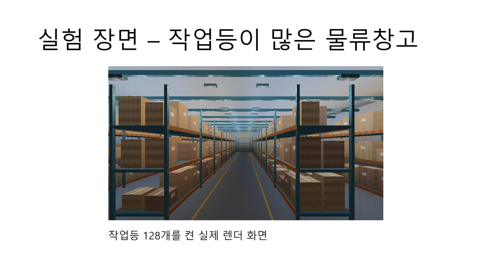
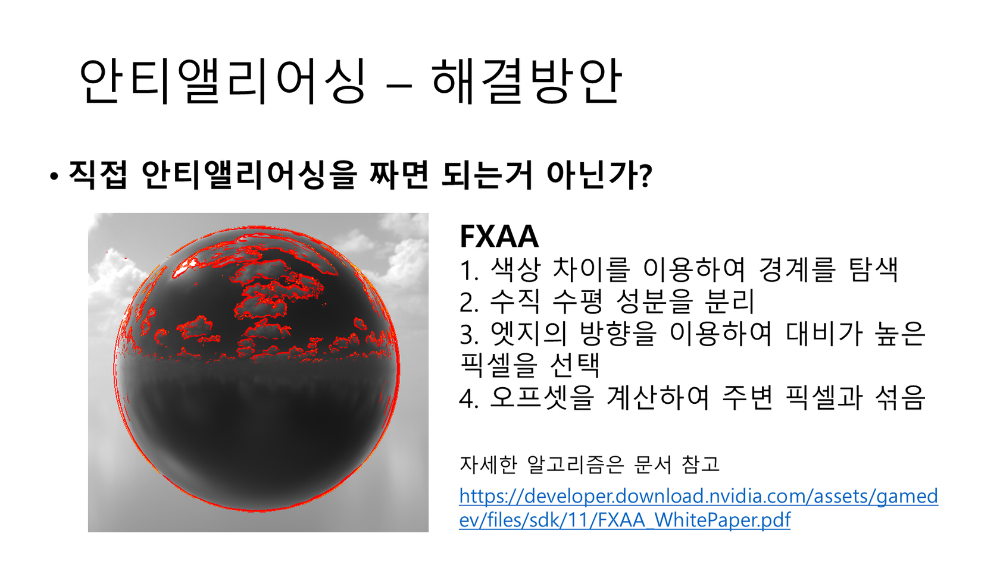

<h1 align="center">Deferred Rendering 소개</h1>

C++과 Direct3D 11로 Forward와 Deferred 렌더링을 비교한 발표 자료

  
  

## Contents

* [프로젝트 소개](#프로젝트-소개)
* [Forward의 낭비와 Deferred의 두 단계](#forward의-낭비와-deferred의-두-단계)
* [G-buffer 구성](#g-buffer-구성)
* [Forward와 Deferred의 성능 비교](#forward와-deferred의-성능-비교)
* [Deferred의 한계](#deferred의-한계)
* [발표 자료](#발표-자료)

## 프로젝트 소개

부경대학교 GDG 2025에서 Deferred Rendering을 주제로 발표한 46쪽 분량의 자료입니다. Forward Rendering이 계산을 낭비하는 지점과 Deferred Rendering이 이를 줄이는 방식을 설명하고, C++과 Direct3D 11로 직접 만든 렌더러에서 두 방식을 같은 조건으로 측정해 "Deferred가 항상 빠른가?"에 답합니다. 창고 장면에서 작업등을 끄거나 8개 켰을 때는 Forward가 빨랐고, 32개와 128개에서는 Deferred가 빨랐습니다. 작업등 128개에서는 GPU 시간이 1.234 ms에서 0.784 ms로 줄었습니다. 발표 후반에는 이 성능 차이의 원인과 안티앨리어싱·투명 물체 처리 비용을 다뤘습니다. [발표 자료 PDF](Deferred%20Rendering%20%EC%86%8C%EA%B0%9C.pdf)

## Forward의 낭비와 Deferred의 두 단계

Forward Rendering은 물체를 그리면서 재질과 조명을 함께 계산합니다. 나중에 그린 물체가 앞을 가리면 이미 계산한 픽셀의 조명은 버려지고, 광원이 많을수록 버려지는 계산도 커집니다.

Deferred Rendering은 이를 두 단계로 나눕니다. 먼저 모든 불투명 물체의 법선과 재질을 G-buffer에 기록합니다. 깊이 테스트를 거치면 픽셀마다 맨 앞 표면의 정보만 남습니다. 그다음 남은 표면에만 조명을 적용하므로, 무거운 조명 계산이 화면에 실제로 보이는 표면에서만 실행됩니다.

## G-buffer 구성

G-buffer는 모든 물체가 쓰고 조명 단계가 다시 읽으므로, 커질수록 메모리 대역폭이 늘어납니다. 직접 구현한 렌더러는 법선, 색상+거칠기, 금속성+차폐광, 깊이의 네 버퍼만 쓰고, MRT(Multiple Render Targets)로 드로우마다 세 색상 타깃에 표면 정보를 기록하고, 깊이 테스트를 통과한 표면의 깊이는 깊이 버퍼에 남깁니다.

위치 버퍼는 두지 않았습니다. 깊이 값으로 정규화 장치 좌표를 만들고 투영·뷰 역행렬을 곱한 뒤 w로 나누면 월드 위치를 복원할 수 있기 때문입니다. 포맷은 값의 범위에 맞췄습니다. 색상, 금속성, 차폐광, 거칠기처럼 [0, 1]로 충분한 값은 `R8G8B8A8_UNORM`에, 법선처럼 범위나 정밀도가 더 필요한 값은 `R16G16B16A16_FLOAT`에 담습니다.

## Forward와 Deferred의 성능 비교

Deferred는 G-buffer를 쓰고 다시 읽는 비용이 추가됩니다. 실제로 항상 빠른지 확인하려고 같은 창고 장면을 두 방식으로 그리고 작업등 수를 바꿔 GPU 시간을 쟀습니다.

* Forward: 단일 패스. 픽셀 셰이더가 실행될 때마다 모든 조명의 범위를 확인합니다.
* Deferred: G-buffer를 기록한 뒤, 광원마다 구형 라이트 볼륨을 그려 덮인 픽셀의 위치를 깊이로 복원하고 반경 안이면 빛을 더합니다.

RTX 4060 Laptop GPU, 1280×720에서 불투명 도형 2,556개를 같은 PBR 재질로 그렸습니다. 깊이 프리패스, 그림자, MSAA, 타일 컬링은 쓰지 않았고, 12프레임 워밍업 뒤 30프레임 × 6라운드를 3회 실행한 중앙값입니다. 두 결과 이미지의 차이는 8비트 채널 기준 최대 1입니다.

<table width="100%">
  <thead>
    <tr>
      <th align="left">작업등</th>
      <th align="right">Forward</th>
      <th align="right">Deferred</th>
      <th align="right">Deferred의 G-buffer</th>
      <th align="right">Deferred의 조명 + 합성</th>
    </tr>
  </thead>
  <tbody>
    <tr>
      <td>꺼짐</td>
      <td align="right">0.152 ms</td>
      <td align="right">0.169 ms</td>
      <td align="right">0.156 ms</td>
      <td align="right">0.013 ms</td>
    </tr>
    <tr>
      <td>8개</td>
      <td align="right">0.177 ms</td>
      <td align="right">0.193 ms</td>
      <td align="right">—</td>
      <td align="right">—</td>
    </tr>
    <tr>
      <td>32개</td>
      <td align="right">0.383 ms</td>
      <td align="right">0.307 ms</td>
      <td align="right">0.146 ms</td>
      <td align="right">0.162 ms</td>
    </tr>
    <tr>
      <td>128개</td>
      <td align="right">1.234 ms</td>
      <td align="right">0.784 ms</td>
      <td align="right">0.147 ms</td>
      <td align="right">0.637 ms</td>
    </tr>
  </tbody>
</table>

조명이 없거나 적을 때는 Forward가 빨랐습니다. Forward는 표면 색을 바로 출력하지만, Deferred는 조명이 없어도 G-buffer 기록 비용(약 0.15 ms)을 그대로 냅니다. 측정한 조건 중 작업등 32개와 128개에서는 Deferred가 빨랐습니다. 128개에서는 Forward 1.234 ms → Deferred 0.784 ms로 36.4% 줄었습니다. Forward는 셰이더가 실행된 모든 픽셀에서 모든 조명을 확인하지만, Deferred는 라이트 볼륨이 덮은 픽셀만 처리하기 때문입니다. G-buffer 시간은 조명 수와 관계없이 일정했고, 늘어난 비용은 조명 단계에만 쌓였습니다.

Forward의 낭비가 가려진 픽셀에서 온다면, 가까운 물체부터 그려 Early-Z가 가려진 픽셀을 미리 걸러 내게 하면 차이가 줄 수 있습니다. 위 표는 가까운 순서로 그린 결과이고, 같은 조건에서 먼 순서로 그리면 작업등 128개의 Forward는 1.581 ms였습니다. 가까운 순서로 바꾸자 Forward의 픽셀 셰이더 호출이 1,934,731회에서 1,625,127회로 약 16% 줄고 시간도 1.581 ms → 1.234 ms로 줄었지만, 여전히 Deferred(0.784 ms)보다 느렸습니다.

이 실험에서 성능을 가른 것은 G-buffer를 기록하고 읽는 비용과, 조명을 계산할 픽셀을 라이트 볼륨으로 줄인 효과였습니다. 가까운 물체부터 그리면 Forward의 가려진 픽셀 계산도 줄지만, 실행된 픽셀 셰이더가 모든 광원의 범위를 확인하는 비용은 남습니다. 조명 반경과 중첩, 해상도가 달라지면 두 방식의 성능 차이도 달라집니다.

## Deferred의 한계

MSAA는 Deferred에서도 쓸 수 있지만, 한 픽셀에 여러 표면이 걸치면 G-buffer에 샘플마다 표면 정보를 저장하고 조명도 샘플마다 계산해야 합니다. 그래서 렌더러에는 최종 색상에서 경계를 찾아 주변 픽셀과 섞는 FXAA를 구현했습니다. G-buffer에 추가 샘플이 필요 없는 대신, 가는 선이나 텍스처가 흐려질 수 있습니다.

G-buffer에는 픽셀마다 맨 앞 표면 하나만 남으므로, 유리처럼 뒤가 비치는 물체는 그대로 그릴 수 없습니다. 발표에서는 세 가지 방법을 비교했습니다. Deferred가 끝난 뒤 반투명 물체만 깊이순으로 정렬해 Forward로 그리는 방법은 기존 방식을 그대로 쓰지만, 물체 단위 정렬이라 서로 관통하는 반투명 물체를 표현하지 못합니다. 디더링은 투명도만큼 픽셀을 솎아 불투명 패스로 그리므로 가볍지만 패턴이 보입니다. Order-Independent Transparency는 픽셀마다 여러 표면을 모아 합성해 순서에 덜 의존하지만 저장 공간이 더 듭니다.

## 발표 자료

* [발표 자료 PDF](Deferred%20Rendering%20%EC%86%8C%EA%B0%9C.pdf)
* [발표 자료 PPTX](Deferred%20Rendering%20%EC%86%8C%EA%B0%9C.pptx)
